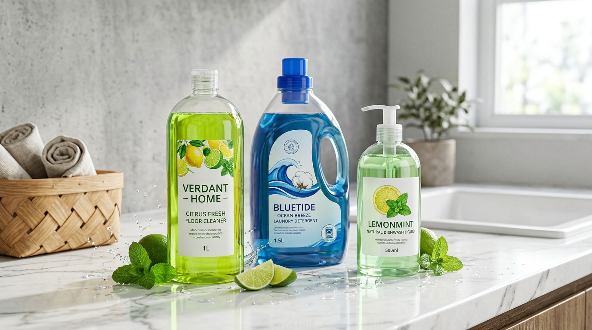

# Varsha Products – Premium E-Commerce & 3D Interactive Website

A modern, responsive e-commerce platform and 3D WebGL product studio engineered for **Varsha Products**, a premier hygiene and specialty chemical manufacturer.



---

## ✨ Features & Architecture

* **Interactive 3D WebGL Studio**:
  * Real-time 3D contoured bottle and industrial drum models rendered with **Three.js**.
  * 360-degree interactive rotation, inertia drag, zoom, and live bubble particle animations.
  * Real-time formulation color switcher (Citrus Fresh, Ocean Breeze, Herbal Pine, Delicate Woolens, B2B SLES Drum).
  * Interactive container inspection hotspots and packaging specs.
* **Modern E-Commerce Storefront**:
  * Comprehensive product catalogue with category filter pills, instant live search, and sorting.
  * Dedicated dynamic routing (`/products/:slug`) with technical batch specifications and related product carousels.
  * Persistent shopping cart powered by **Zustand** and `localStorage`.
  * Slide-out cart drawer with dynamic subtotal calculations.
* **Transparent B2B / B2C Order Enquiry Workflow**:
  * Form validation with **React Hook Form** + **Zod**.
  * Generates traceable order reference IDs (e.g. `VP-2026-XXXX`).
  * Direct 1-click **WhatsApp order forwarding** with prepopulated order item details.
* **Corporate & Technical Profiles**:
  * About Us page highlighting 120,000 L daily capacity and 8-stage QA lifecycle.
  * Industrial services page covering Contract OEM, Private Label, and B2B Surfactant supply.
  * Fully responsive across Mobile, Tablet, Laptop, and Desktop screens.

---

## 🎨 Brand Color Palette

| Color | Hex | Usage |
| :--- | :--- | :--- |
| **Primary Purple** | `#7D2D76` | Primary brand identity, buttons, badges |
| **Deep Plum** | `#56344F` | Hero gradient, dark sections, footer |
| **Mustard Yellow** | `#E3C058` | Announcement bar, B2B highlights, badges |
| **Pink** | `#EE6B8B` | Promotional badges, discount chips |
| **Lavender** | `#DDCFE6` | Light background accents and borders |
| **Golden Yellow** | `#D2AE34` | Special offers and industrial chemical tags |
| **Dark Plum** | `#46394A` | Footer, high-contrast dark text |
| **Off-White** | `#FAF8FC` | Clean modern page background |

---

## 🛠️ Tech Stack

* **Frontend**: React 19, TypeScript, Vite
* **Styling**: Tailwind CSS, PostCSS, Lucide React Icons
* **3D Graphics**: Three.js (WebGL, Lathe geometries, PBR Physical Materials)
* **Routing**: React Router DOM v7
* **State Management**: Zustand (with persistent middleware)
* **Form Validation**: React Hook Form, Zod

---

## 🚀 Getting Started

### 1. Clone the repository
```bash
git clone https://github.com/Sreepriyanth2005/varsha.git
cd varsha
```

### 2. Install dependencies
```bash
npm install
```

### 3. Run development server
```bash
npm run dev
```
Open [http://localhost:5173](http://localhost:5173) in your browser.

### 4. Build for production
```bash
npm run build
```
Optimized assets will be generated in the `dist/` directory.

---

## 📄 License
© 2026 Varsha Products. All rights reserved.
